# Family Health

[](https://github.com/hasnat-abdullah/family-health/actions/workflows/ci.yml)
[](https://github.com/hasnat-abdullah/family-health/releases/latest)
[](LICENSE)

Private medical records for the whole family, on macOS, iPhone, iPad and Android, built with Flutter. Offline by default: nothing leaves the device unless you turn on AI reading with a cloud provider.

> [!IMPORTANT]
> Family Health is a personal record keeper, not a medical device. It doesn't give medical advice, and reading a report can go wrong, so always check values against the original and talk to a doctor about your results.

## Screenshots

All screenshots show the made-up demo family.

### macOS

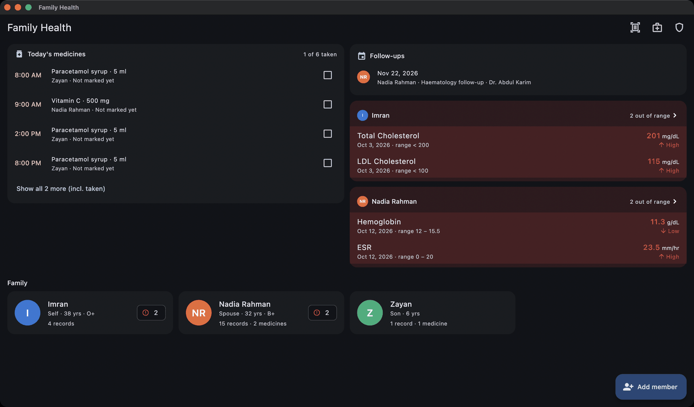

| Trend chart | Member health |
|---|---|
| 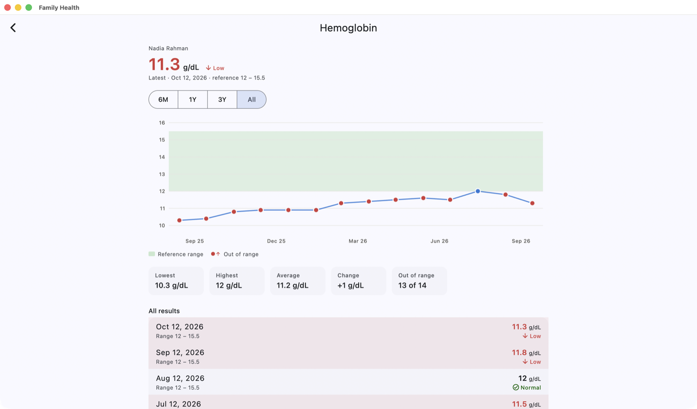 | 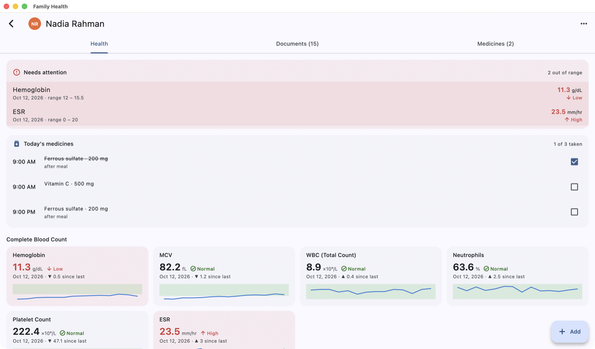 |

### iPhone

| Home | Member health | Trend chart | Medicines | Dark mode |
|---|---|---|---|---|
| 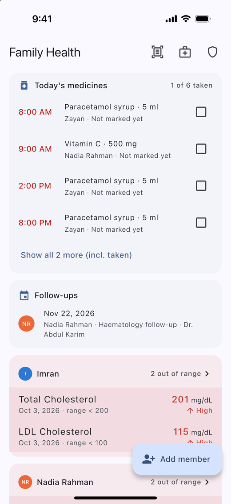 | 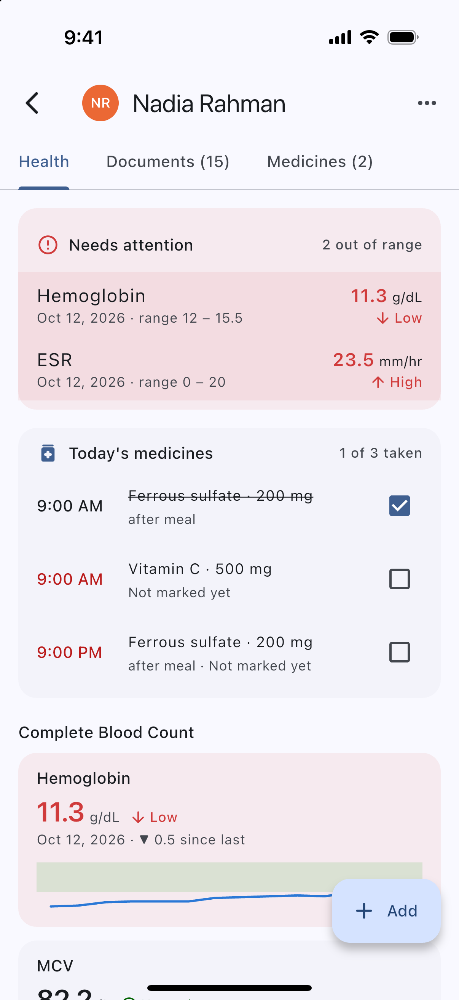 | 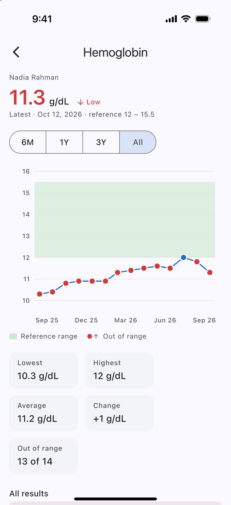 | 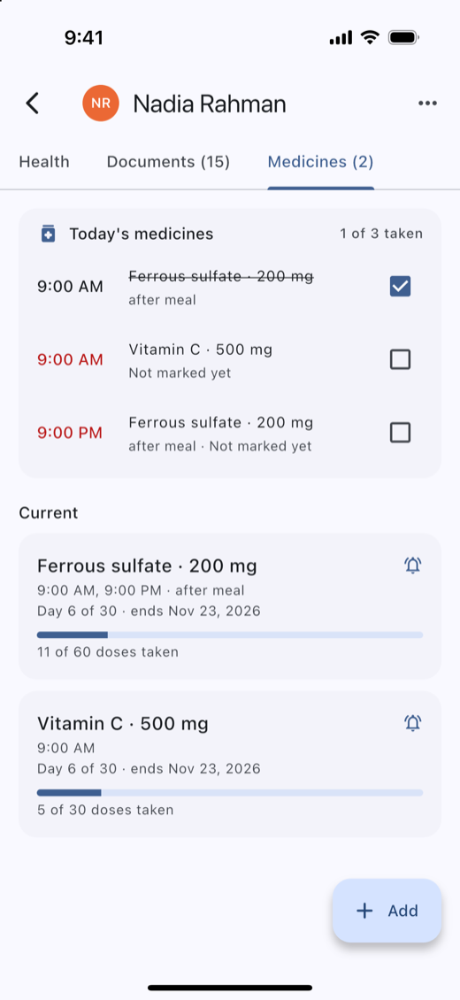 | 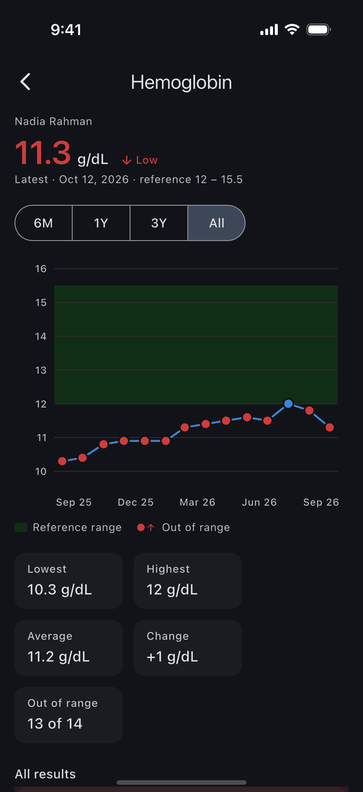 |

### iPad

| Home | Trend chart | Dark mode |
|---|---|---|
| 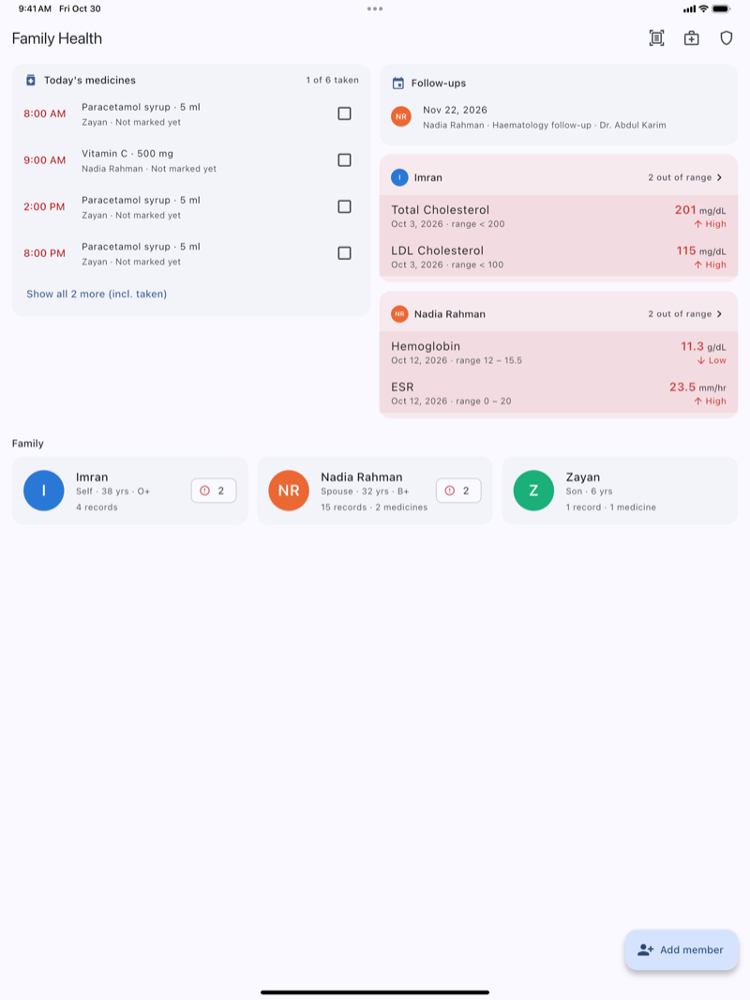 | 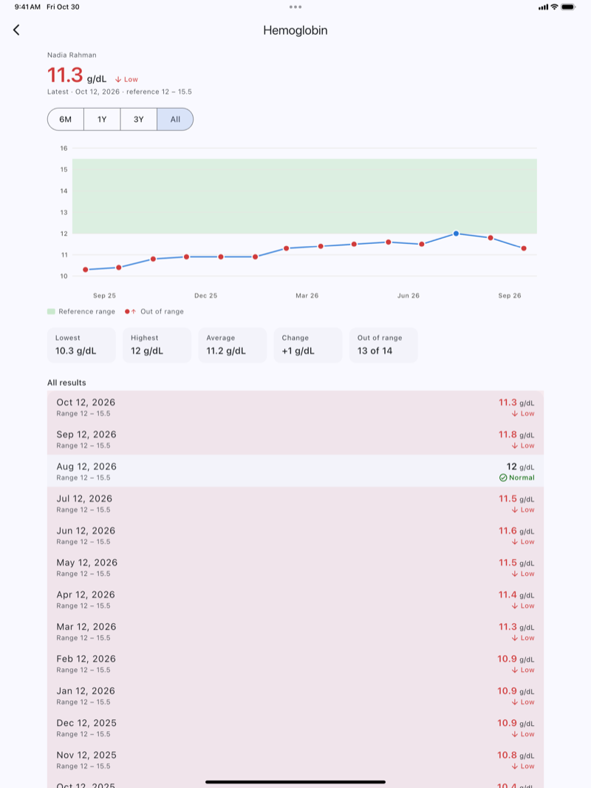 | 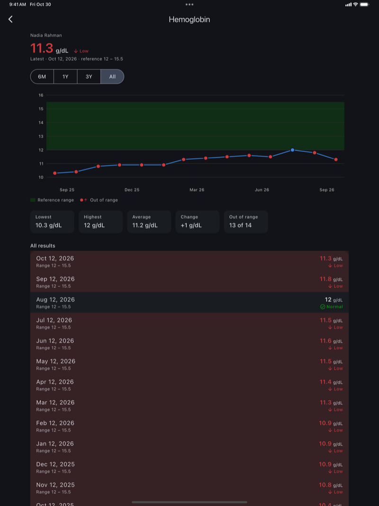 |

### Android

| Home | Member health | Trend chart | Medicines | Dark mode |
|---|---|---|---|---|
| 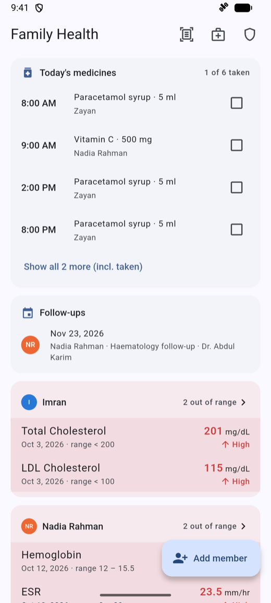 | 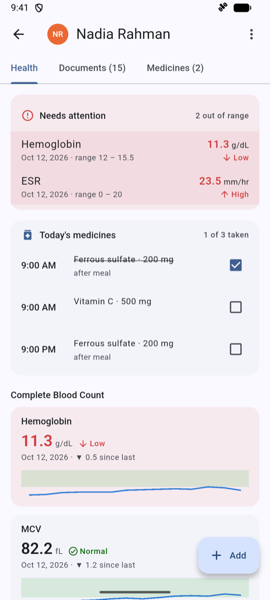 | 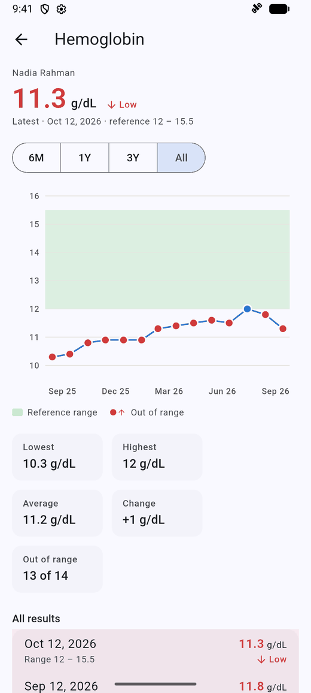 | 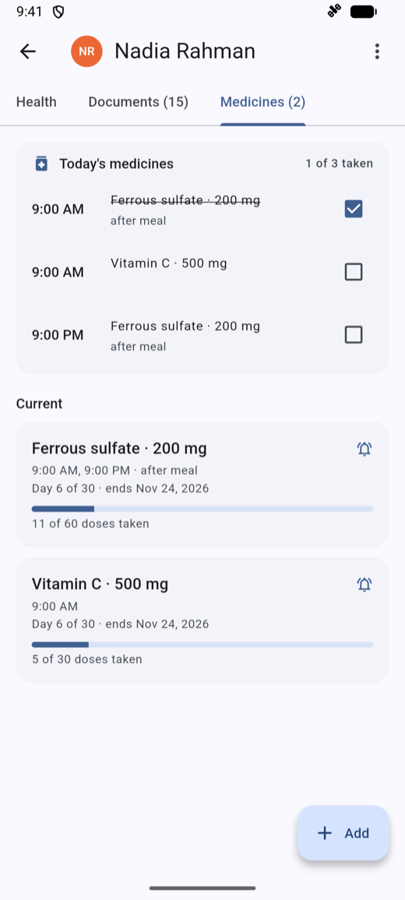 | 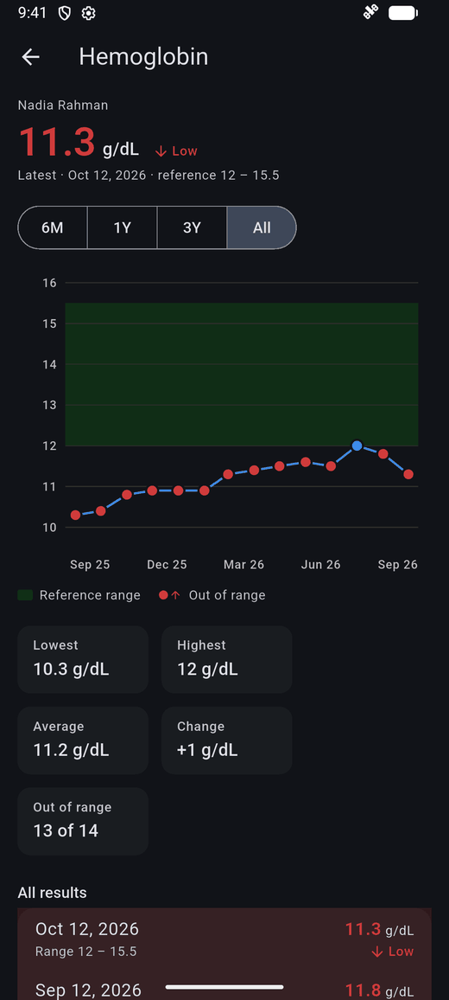 |

## Features

- **Profiles** for each family member (photo, relation, date of birth, sex, blood group, notes).
- **Doctors**: one page per doctor with everything from them, for every family member they treat, filterable by person. Each member's Documents tab can also filter by doctor.
- **Lab reports**: import a photo, PDF or CSV, or type values in. Values are read **on the device**: PDFs that contain text are read directly, and photos and scanned PDFs go through OCR (Apple Vision on iOS/macOS, ML Kit on Android). You check every value against the original before it is saved.
- **Trends**: a chart per test with the reference range shaded. Out-of-range results are shown in red with ↑ High / ↓ Low labels, and each chart has a list of all values.
- **Needs attention**: tests whose latest result is out of range, shown on the home screen and on each profile.
- **Documents**: prescriptions, X-rays and scans, discharge summaries, vaccination cards and other papers, stored as the original image or PDF.
- **AI reading (optional)**: Gemini, OpenAI, Anthropic or a local model reads a report or prescription into results, medicines, doctor, dates and follow-up, saved with the original file. See [AI reading](#ai-reading).
- **Import a pile**: the import button on the home screen takes several files, files each under the right person, and spots files already in the archive.
- **Follow-ups**: a date on a record appears on the home screen, with a reminder the day before.
- **Medicines**: courses with dose times and length (or ongoing), notification reminders until the course ends, a checklist of today's doses, and progress.
- **Export/import**: one member or the whole family as a `.medarchive` file (data plus original files). Importing merges records, so importing the same file twice is safe. Results can also be exported as CSV.

## Install

Download the file for your device from the [latest release](https://github.com/hasnat-abdullah/family-health/releases/latest). `SHA256SUMS.txt` lists a checksum for each one.

| Device | Needs | File |
|---|---|---|
| Mac (Apple silicon or Intel) | macOS 12 or later | `FamilyHealth-<version>-macos.dmg` |
| iPhone and iPad | iOS/iPadOS 15 or later | `FamilyHealth-<version>-ios-unsigned.ipa` |
| Android phone or tablet | Android 7.0 or later | `FamilyHealth-<version>-android-arm64.apk` for most devices, or `-universal.apk` if unsure |

Your records stay on the device. Use **Security & backup** to export a `.medarchive` backup before you reinstall or move to a new device.

### macOS

The app isn't notarized by Apple, because that needs a paid developer account, so macOS blocks it the first time.

1. Open the `.dmg` and drag **Family Health** to **Applications**.
2. Allow it to open, by running this in Terminal:

   ```sh
   xattr -dr com.apple.quarantine "/Applications/Family Health.app"
   ```

   Or try opening the app, then choose **System Settings → Privacy & Security → Open Anyway**.
3. Open the app.

After installing an update, macOS asks once for your login password so the new build can read its encryption key from the keychain. Enter it and choose **Always Allow**. Don't choose Deny: the app can't open your records without that key.

### Android

1. Download the `.apk` on the device and open it.
2. Allow your browser or file manager to install unknown apps when asked.
3. Tap **Install**.

Later releases install over the old one. Stay with the same kind of APK when updating: Android won't let you switch from an `arm64` APK to a `universal` one without uninstalling first, so export a backup before you do.

### iPhone and iPad

Apple only allows signed apps, and the release file isn't signed, so there are two ways to install it. The same file works on iPhone and iPad.

- **Sideload the `.ipa`.** Use [AltStore](https://altstore.io/) or [Sideloadly](https://sideloadly.io/) on a computer, and sign it with your own Apple Account. Open the tool, add the `.ipa`, and choose your device.
- **Build it yourself** with Xcode, as described below.

With a free Apple Account, the app stops opening after 7 days until you sign it again. Your data stays on the device as long as you don't delete the app. A paid Apple Developer account extends that to a year.

## Build from source

You need [Flutter](https://docs.flutter.dev/get-started/install) 3.47 or later (Dart 3.13), and then for each platform:

| To build for | You need |
|---|---|
| macOS, iPhone, iPad | A Mac with Xcode and [CocoaPods](https://cocoapods.org/) |
| Android | Android Studio or the Android SDK, and JDK 17 |

```sh
git clone https://github.com/hasnat-abdullah/family-health.git
cd family-health
flutter pub get
flutter doctor                    # shows anything still missing
flutter doctor --android-licenses # Android only, once
```

To try the app with a made-up family, kept in separate demo storage, add `--dart-define=DEMO=true` to any `flutter run` command.

### macOS

```sh
flutter run -d macos                 # run
flutter build macos --release        # build
open "build/macos/Build/Products/Release/Family Health.app"
```

### Android

Start an emulator or connect a phone with USB debugging on, then:

```sh
flutter devices                      # find the device id
flutter run -d <device-id>           # run
flutter build apk --release          # build: build/app/outputs/flutter-apk/app-release.apk
flutter install -d <device-id>       # install that build
```

Building an app bundle (`flutter build appbundle`) also needs **Android SDK Command-line Tools**, which you can add in Android Studio's SDK Manager.

### iPhone and iPad

For a simulator, no account is needed:

```sh
open -a Simulator                    # pick an iPhone or iPad under File → Open Simulator
flutter run -d <simulator-id>
```

For a real device, sign the app once with your Apple Account:

1. Connect the device and trust the computer. Turn on **Settings → Privacy & Security → Developer Mode** if asked.
2. Run `open ios/Runner.xcworkspace`.
3. Select **Runner → Signing & Capabilities**, tick **Automatically manage signing**, and choose your team.
4. If Xcode says the bundle identifier is taken, change it to something of your own, like `com.yourname.familyhealth`.
5. Build and install:

   ```sh
   flutter devices                   # find the device id
   flutter run --release -d <device-id>
   ```

6. The first time, trust yourself on the device under **Settings → General → VPN & Device Management**.

## AI reading

Off by default. Turn it on under Security & backup → AI document reading, with your own API key or a local server. Keys are kept in the secure keychain and are never in backups. A cloud provider asks for agreement once before its first document.

| Provider | Default model | Notes |
|---|---|---|
| Google Gemini | `gemini-3.8-flash` | `generateContent` with a response schema |
| OpenAI | `gpt-6.1-sol` | Chat Completions with a strict JSON schema |
| Anthropic | `claude-opus-5-5` | Messages with `output_config.format`; server-side fallback on refusals where offered |
| Local | you choose | Any OpenAI-compatible server (Ollama, LM Studio). Plain http is allowed only to private addresses |

Any model name can be typed in. Reading is built so that a wrong answer is caught rather than trusted:

- **The model transcribes; code interprets.** It returns strings as printed. Numbers, ranges, unit conversions, dates and dose schedules are worked out by the same deterministic code as on-device reading.
- **Nothing about the family is sent**, only fixed instructions and the document, so there are no names or past values to copy. Which member a document belongs to is decided on the device from the printed name, with sex and age as cross-checks.
- **Every value is checked against an independent reading** (the PDF's text or on-device OCR, plus the heuristic parser). Rows are marked confirmed, on the page but not tied to the row, not found, in conflict (with the other value one tap away), unreadable, or not checkable. Values far from the last result, or contradicting a printed H/L, are flagged too.
- **You review before saving.** Unconfirmed items are highlighted and need an explicit "Save anyway". Handwriting usually can't be cross-checked, so check those by eye.

Failures never lose work. The original is stored first and on-device values stay on screen, so an API error shows a plain message with Try again. Busy, rate-limit and network errors are retried with backoff (honouring `Retry-After` up to 30 seconds); bad keys, missing models and billing errors are not. A malformed reply is asked for once more, then discarded whole. Up to 10 pages are read per document, and the screen says so if pages were skipped.

## Tests

```sh
flutter test                                        # parser, CSV, medicine schedule, AI client and checks
flutter test integration_test/data_flow_test.dart -d macos   # one on-device suite
tool/test_device.sh <device-id> <label> <log-dir>   # every on-device suite on one device
```

See [CONTRIBUTING.md](CONTRIBUTING.md) for more, including releases.

## Layout

| Path | What |
|---|---|
| `lib/data/` | models, SQLite database (`database.dart`), original-file store, lab test catalog (aliases, units, default ranges, unit conversion) |
| `lib/services/` | report reader (PDF/OCR), report parser, CSV, backup, reminders, file pick/share |
| `lib/services/ai/` | settings, provider clients (retries, errors, cancel), prompt and schema, page preparation, checks |
| `lib/screens/`, `lib/widgets/` | UI |
| `packages/report_ocr/` | small local plugin: Apple Vision (shared Swift for iOS/macOS) and ML Kit (Android) |
| `integration_test/` | on-device suites and the README screenshot walk |
| `tool/` | scripts for on-device tests, backups between OSes, and screenshots |
| `.github/workflows/` | CI, and installable builds for each release |

## Things to know

- **Reading reports is heuristic.** It matches about 50 common tests (CBC, sugar, lipids, kidney, liver, thyroid, electrolytes, iron/vitamins) by the names labs print. It converts `/cumm` counts (for example `7,500`, `2,50,000`) and mg/dL ⇄ mmol/L so trends stay comparable. Unknown tests are picked up when the row has a printed range. You always review before saving.
- **Reference ranges** come from the report when it prints one, and otherwise from typical adult values (by sex). They are for orientation, not medical advice.
- **Reminders** are local notifications. iOS allows only 64 pending notifications per app, so the app keeps a rolling window of the next 60 untaken doses (up to 14 days ahead) and refreshes it every time it opens. If the app isn't opened for about two weeks, reminders pause until it is. Marking a dose taken cancels its reminder.
- **Backups** are encrypted with a password you choose, and include profile pictures and doctors. They do not include AI keys.
- **Ready for cloud sync later**: every record has a UUID and an `updated_at` timestamp, and import already merges with "last edit wins". Deletions don't sync yet; that would need soft-delete markers.

## Contributing

Contributions are welcome: see [CONTRIBUTING.md](CONTRIBUTING.md) and the [Code of Conduct](CODE_OF_CONDUCT.md). Please report security problems privately, as described in [SECURITY.md](SECURITY.md).

## License

[MIT](LICENSE). On Android, text recognition uses Google's ML Kit, which is free to use but closed source and has its own [terms](https://developers.google.com/ml-kit/terms).
